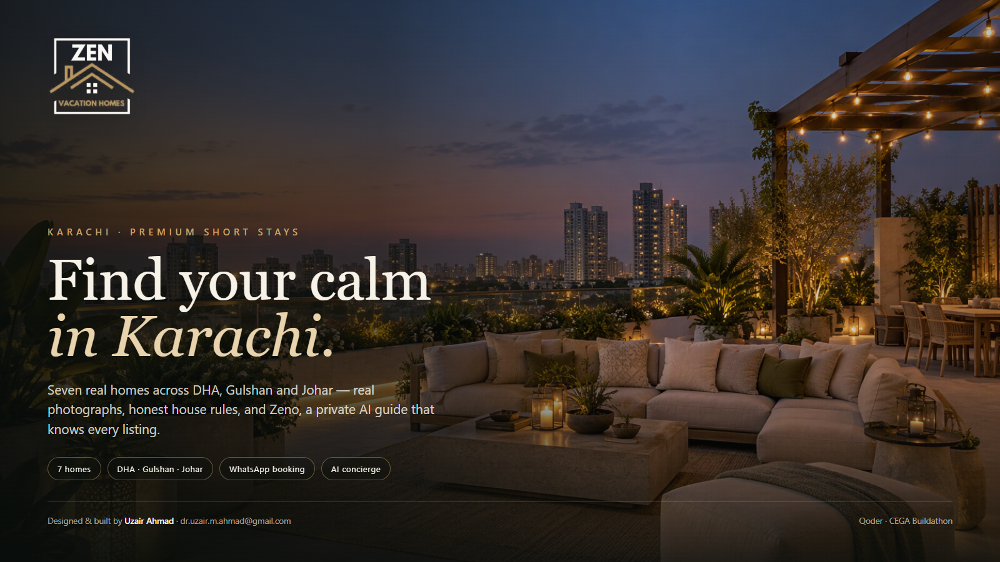
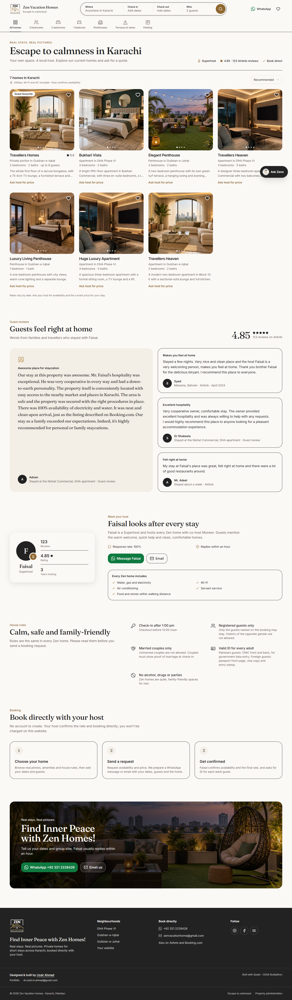
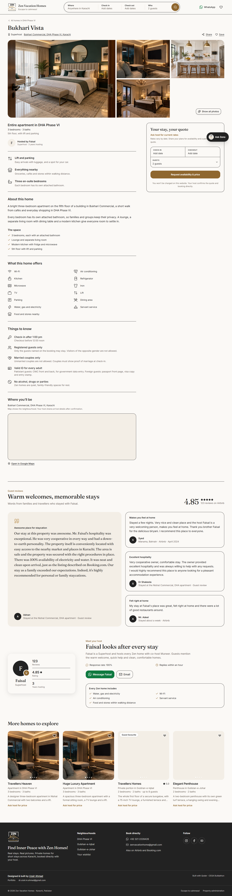
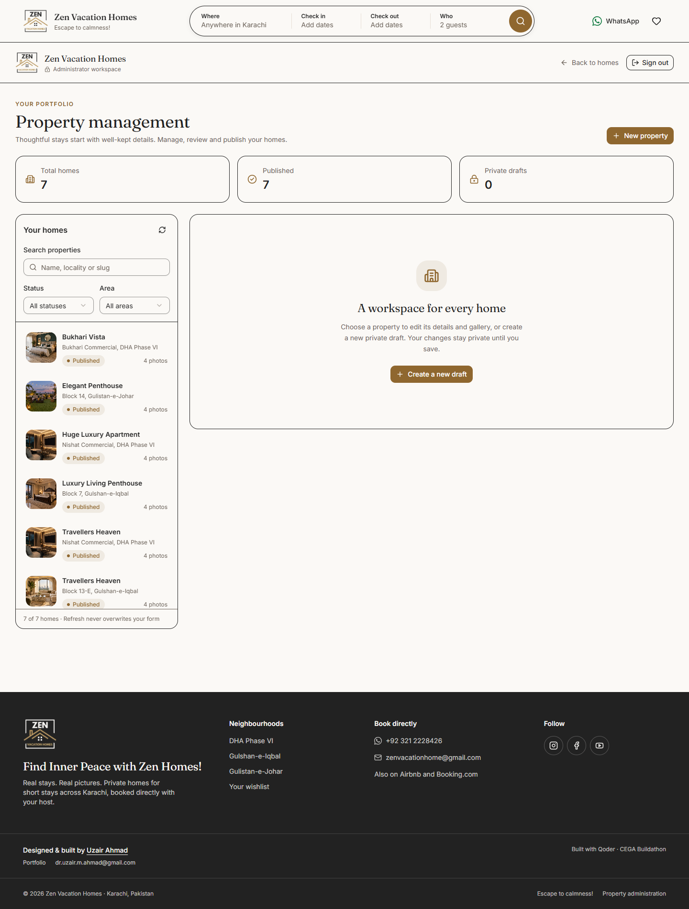
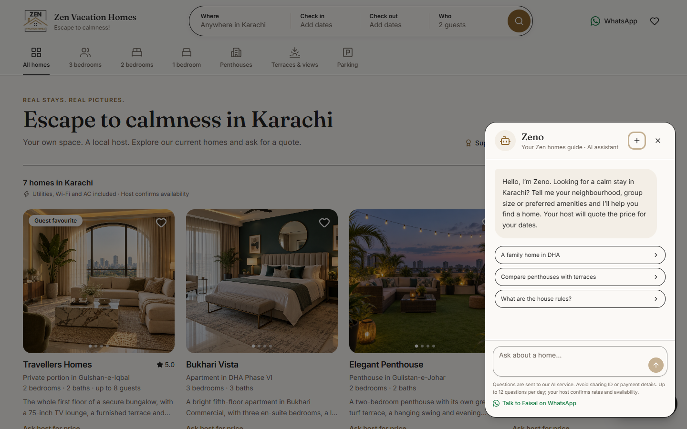

<p align="center"></p>

<h1 align="center">Zen Vacation Homes</h1>

<p align="center"><strong>A premium short-stay rental platform for Karachi — real homes, an AI concierge, direct WhatsApp booking and a private property-management panel.</strong></p>

<p align="center">
  
  
  
  
  
  
</p>

---

## The product

Zen Vacation Homes is a real hospitality business in Karachi with seven homes across DHA Phase VI, Gulshan-e-Iqbal and Gulistan-e-Johar. This repository is the complete platform behind it:

https://zen-vacation-homes-1oqxsipmfn5.qoder.website/


- **An Airbnb-grade guest experience** — photo-led browsing, filters, wishlist, full listing pages, house rules, guest reviews and neighbourhood context.
- **Booking without a checkout** — guests prepare a WhatsApp message or email with the home, dates and group size. The host confirms availability and quotes the final rate directly. **No prices are shown anywhere**; nothing is invented.
- **Zeno, an AI concierge** — a streaming assistant that answers only from the live catalog, recommends homes with links, explains policies, refuses to quote rates, and hands the guest to the host.
- **A private administrator panel** — create, edit, publish, draft and delete homes; upload, reorder and caption photos; every save is versioned and idempotent.
- **A hardened edge backend** — one Deno function owning authentication, validation, quotas, storage and the AI transport.

| Home | Listing | Admin panel | Zeno |
| --- | --- | --- | --- |
|  |  |  |  |

> Screenshots run against the bundled demo catalog. Photography in this repository is a generated demo set; the live deployment uses the owner's real photos, which are deliberately kept out of the public repository.

---

## Work with the developer

**Uzair Ahmad** — full-stack developer. This project was designed and built end-to-end by one developer: the visual system, the frontend, the edge backend, the database layer, the AI integration, the security model, the test suite and the deployment.

**Skills demonstrated in this repository**

| Area | What was built here |
| --- | --- |
| Frontend engineering | React 19 + TypeScript SPA, custom client router, context-driven catalog, SSR-free performance |
| UI / UX design | Tailwind 4 design tokens, shadcn-style primitives, a complete visual identity, responsive layouts, accessible dialogs and focus management |
| Backend engineering | Deno edge function, REST-style routing, request validation, bounded JSON parsing, safe error projection |
| Data & concurrency | PostgreSQL JSON document store, optimistic versioning, fenced leases, atomic quota reservation, idempotency keys |
| AI engineering | Streaming LLM integration (Managed SSE), server-side grounding, durable conversations, reconnect without resend, cost and quota limits |
| Security | Constant-time password checks, digest-stored sessions, `__Host-` cookies, origin enforcement, upload magic-byte validation, rate limiting |
| Reliability & QA | 11 automated backend tests, live end-to-end CRUD verification, deterministic build, honest error states |
| Deployment | Qoder Sites static + function deployment, database schema, secrets management |

**Available for client work.**

- Email: **dr.uzair.m.ahmad@gmail.com**
- LinkedIn: **[linkedin.com/in/uzairahmad02](https://www.linkedin.com/in/uzairahmad02/?originalSubdomain=pk)**
- Portfolio: **[druzairahmadrph.netlify.app](https://druzairahmadrph.netlify.app/)**

Built with **Qoder · CEGA Buildathon**. If you are a hotel, guest house or short-stay operator who wants a website like this — with a private admin panel and your own AI concierge — get in touch.

---

## Stack

| Layer | Technology |
| --- | --- |
| Frontend | React 19.2, TypeScript 5.9, Vite 8, client-side router |
| Styling | Tailwind CSS 4.2, Radix UI primitives, shadcn-style component catalog, Embla Carousel, lucide icons, sonner toasts |
| Backend | One Deno edge Function (`functions/index.ts`) on Qoder Sites |
| Database | PostgreSQL (`app.zen_state` JSON document store) via the platform client |
| Storage | Qoder Sites Storage, served through an authorized image endpoint |
| AI | Qoder Cloud Agents (Managed SSE), server-grounded with the live catalog |
| Build | `tsc --noEmit` + Vite → `dist/` (SPA fallback) |
| Tests | Node's built-in test runner with an in-memory database/storage |

### Architecture

```text
Browser ── static SPA ───────────────────────────────► Edge (dist/, spa: true)
   │
   ├── GET  /functions/v1/app/api/properties ────────► Function ─► app.zen_state (published homes)
   ├── /api/admin/* (session cookie + Origin) ───────► Function ─► app.zen_state + Storage
   └── /api/chat/* (visitor token, SSE) ────────────► Function ─► Qoder Cloud Agents
                                                                     └─► streamed snapshots
```

The browser never holds database credentials, storage keys or AI tokens. All authorization, validation, quotas and history live in the Function.

---

## HTTP API

All routes are served under `/functions/v1/app`.

| Method | Path | Access | Purpose |
| --- | --- | --- | --- |
| GET | `/api/health` | Public | Liveness and revision |
| GET | `/api/properties` | Public | Published homes only |
| GET | `/api/property-images/:id` | Public if published, admin otherwise | Authorized image serving |
| GET | `/api/admin/session` | Public | Reports password configured + session state |
| POST | `/api/admin/login` | Public, rate limited | Constant-time sign-in, sets `__Host-zen_admin` |
| POST | `/api/admin/logout` | Admin | Revokes session |
| GET | `/api/admin/properties` | Admin | All homes, drafts included |
| POST | `/api/admin/properties` | Admin | Create (idempotency key) |
| PATCH | `/api/admin/properties/:slug` | Admin | Edit (expected version) |
| DELETE | `/api/admin/properties/:slug` | Admin | Delete (expected version) |
| POST | `/api/admin/properties/:slug/uploads` | Admin | Start photo upload |
| POST | `/api/admin/uploads/:id/complete` | Admin | Finalize validated upload |
| GET | `/api/chat/config` | Visitor token | Chat mode |
| GET/POST | `/api/chat/conversations` | Visitor token | List / create conversations |
| GET | `/api/chat/conversations/:id` | Visitor token | Read conversation |
| POST | `/api/chat/conversations/:id/messages` | Visitor token | Send message (202 accepted) |
| GET | `/api/chat/conversations/:id/events` | Visitor token | SSE snapshots (`ready`, `snapshot`, `stream-error`) |

Every non-GET request must carry the exact site `Origin`. Creates and uploads require an `idempotency-key` UUID. Updates require the current `version` (`409 write_conflict` otherwise). Chat requests identify the visitor with a 64-hex `x-zen-visitor` token whose digest — never the token — is stored.

---

## Data model

```sql
CREATE TABLE app.zen_state (
  key text PRIMARY KEY,
  version bigint NOT NULL DEFAULT 1,
  token text NOT NULL DEFAULT '',
  expires_at bigint NOT NULL DEFAULT 0,
  value jsonb
);
```

A versioned JSON document store used for the catalog, admin sessions (by token digest), upload intents, Zeno conversations, daily quotas and coordinator leases. The owner's edits are stored here; the bundled seed catalog is only the starting point.

## Zeno, the AI concierge

- Each question is grounded server-side with the current published catalog; property text is treated as data, never instructions.
- Conversations are durable: messages are persisted, streams reconnect to a snapshot, and an unknown dispatch outcome is reconciled instead of being resent.
- Limits: 12 questions per visitor per day, 3 new conversations per visitor per day, 100 sends per day, 5 conversations per visitor, 45-second stream lifetime.
- Zeno never quotes prices, never claims availability, never collects identity documents in chat, and refuses to reveal internal configuration.

---

## Administrator portal

The admin panel lives at **`/admin`** (for example `https://<your-site>/admin`).

**Local development**

1. Start the API and frontend (`node --experimental-strip-types dev/server.mjs`, then `npm run dev`).
2. Open `http://127.0.0.1:5173/admin`.
3. Sign in with the local-only test password **`local-only-test-password-2026`** (defined in `dev/server.mjs`; it never works in production).

**Production**

1. Open **Site Settings → Secrets** for the published site and add `APP_ADMIN_PASSWORD` (minimum 16 characters). The value belongs in that form only — never in chat, issues or source files.
2. Publish the site so the Function picks up the secret.
3. Visit `/admin`, sign in with that password. Sessions last 8 hours and are `HttpOnly`, `Secure`, `SameSite=Strict`.
4. From the panel you can create a new property, edit every text field, upload photos, reorder and caption them, save drafts, publish (photos, summary, locality, address and map query required) and delete with confirmation.

If `/admin` reports that setup is required, the `APP_ADMIN_PASSWORD` secret has not been configured for the current release yet.

---

## Local development

Requires Node.js `^22.13.0` or `>=24.0.0`.

```sh
npm install
node --experimental-strip-types dev/server.mjs   # API on 127.0.0.1:8000, in-memory DB + storage
npm run dev                                      # SPA on 127.0.0.1:5173 (proxies the API)
```

Tests:

```sh
node --experimental-strip-types --test dev/property-service.test.mjs dev/zeno-service.test.mjs
```

11 tests cover admin authentication and lockout, session privacy, versioned writes, draft visibility, upload validation, delete semantics, Zeno dispatch idempotency, lease fencing and stream recovery.

Build:

```sh
npm run build    # typecheck + static build into dist/
npm run preview
```

Local chat endpoints exist, but real AI replies require the deployed Function with the platform-managed `QODER_PAT`; locally the UI reports chat as unavailable rather than pretending to answer.

---

## Live demo (static hosting)

- **GitHub Pages:** https://ua6546830-ai.github.io/zen-vacation-homes/ — the complete browsing experience on the bundled demo catalog.
- **Vercel:** [](https://vercel.com/new/clone?repository-url=https://github.com/ua6546830-ai/zen-vacation-homes) — one click deploys `main` as a static site (`vercel.json` included).

`npm run build` writes `public/catalog.json` (demo snapshot), and the app falls back to it when no API is reachable, so static hosts render every home. The admin panel and Zeno need the full Qoder Sites deployment below.

---

## Deployment (Qoder Sites)

1. Publish `dist` with `spa: true`.
2. Include `functions/` as the Function directory (the platform injects `functions/_qoder/`).
3. Enable the database with `read_write` access and apply `schema.sql`.
4. Add `APP_ADMIN_PASSWORD` (16+ characters) in Site Settings → Secrets.
5. `QODER_PAT` is provisioned automatically by the platform. Never add it as an application secret.
6. Update `siteOrigin` in `functions/index.ts` if the site moves to another domain.

The current live site uses **private (invite-only)** access; the hosting plan does not offer anonymous public access.

Other hosting providers can serve the static `dist/` without the API, but the admin panel and Zeno need an equivalent edge runtime with database, object storage and an AI provider.

---

## Project structure

```text
functions/            Deno edge Function: routing, catalog, property service, Zeno service,
                      Cloud Agents client, coordinator, SSE transport
src/                  App shell, pages, global styles
components/           Site header/footer, cards, gallery, search, booking, Zeno dialog,
                      admin panel, vendored UI primitives
lib/                  Catalog + admin API clients, router, wishlist state, SSE reader
public/               Logo, favicons, demo photography
docs/brand/           Marketing banner, social card and their HTML sources
docs/screenshots/     README screenshots
dev/                  Local API harness, in-memory backend, test suite
scripts/              Node version check and build script
schema.sql            Database table
vendor/               Vendored stylesheet with its license
PROVENANCE.md         Third-party attribution
```

## Demo data, photography and IP

This repository is a **showcase build**:

- Property photography is **generated demo imagery**, not the client's photos. Real photography belongs to Zen Vacation Homes and is kept in a private folder outside this repository.
- Street-level addresses and unit identifiers have been generalised to neighbourhood level.
- Business contact details, house rules and guest reviews are published with the owner's permission for demonstration.

The live deployment contains the owner's real photos and precise address data in its database and storage — not in this repository.

## License

**All rights reserved.** This repository is published for portfolio review and demonstration. Copying, redistributing or reusing the code, design or content for another product is not permitted without written permission from Uzair Ahmad. See [LICENSE](LICENSE).

Third-party libraries keep their own licenses; see [PROVENANCE.md](PROVENANCE.md).

---

<p align="center"><sub><strong>Zen Vacation Homes</strong> · Karachi, Pakistan · Designed &amp; built by <a href="https://druzairahmadrph.netlify.app/">Uzair Ahmad</a> · Qoder · CEGA Buildathon</sub></p>
